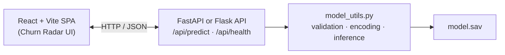

# Churn Radar
**Telco Customer Churn Prediction — from notebook to production-ready application**
> Telco Customer Churn Prediction — from notebook to production-ready application
[](https://telco-customer-churn-analysis-beta.vercel.app/)
[](https://www.python.org/)
[](https://react.dev/)
[](https://fastapi.tiangolo.com/)
[](https://telco-customer-churn-analysis-beta.vercel.app/)
[](https://www.python.org/)
[](https://react.dev/)
[](https://fastapi.tiangolo.com/)
**Churn Radar** predicts whether a telecom customer is likely to cancel their service, using a Decision Tree classifier trained on the [IBM Telco Customer Churn dataset](https://www.kaggle.com/datasets/blastchar/telco-customer-churn). The project takes that model out of a notebook and wraps it in a validated REST API and a polished React interface — ready to demo, deploy, or extend.
**Live demo:** [telco-customer-churn-analysis-beta.vercel.app](https://telco-customer-churn-analysis-beta.vercel.app/)
**Live application:** [https://telco-customer-churn-analysis-beta.vercel.app/](https://telco-customer-churn-analysis-beta.vercel.app/)
**Churn Radar** predicts whether a telecom customer is likely to cancel their service. It uses a Decision Tree classifier trained on the [IBM Telco Customer Churn dataset](https://www.kaggle.com/datasets/blastchar/telco-customer-churn) and wraps that model in a validated REST API plus a React interface — ready to demo, deploy, or extend.
---
## Table of Contents
- [Highlights](#highlights)
- [Tech Stack](#tech-stack)
- [Architecture](#architecture)
- [Project Structure](#project-structure)
- [API Reference](#api-reference)
- [Getting Started](#getting-started)
- [Deployment](#deployment)
- [Engineering Notes](#engineering-notes)
---
## Highlights
| Feature | Description |
|---------|-------------|
| **Dual backend architecture** | The same prediction logic runs in both **Flask** and **FastAPI**, sharing a single `model_utils.py` module — demonstrating framework versatility and clean separation of concerns. |
| **Verified correctness** | The feature-encoding pipeline was validated row-for-row against the original training data (`tel_churn.csv`) so API predictions match the trained model exactly. |
| **Strict input validation** | Every request is validated against expected categories and types before inference, returning clear `422` errors instead of silent failures. |
| **Interactive UI** | A custom animated signal gauge visualizes churn probability, built from scratch in SVG — not just numbers in a table. |
| **Batch predictions** | Score a single customer or a full list in one request, aligned with real retention workflows. |
| **Self-documenting API** | FastAPI's interactive Swagger docs at `/docs` let anyone explore and test the API with zero setup. |
| :------ | :---------- |
| Dual backend architecture | Same prediction logic in **Flask** and **FastAPI**, sharing one `model_utils.py` module |
| Verified correctness | Feature encoding validated row-for-row against `tel_churn.csv` |
| Strict input validation | Invalid requests return clear `422` errors before inference |
| Interactive UI | Custom SVG signal gauge for churn probability |
| Batch predictions | Score one customer or a full list in a single request |
| Self-documenting API | FastAPI Swagger docs at `/docs` for zero-setup exploration |
---
## Tech Stack
**Frontend**
### Frontend
- React 18 + Vite
- Custom CSS design system (no UI framework)
- Hand-rolled SVG data visualization (signal gauge)
- Hand-rolled SVG signal gauge
**Backend**
- FastAPI — Pydantic-validated schemas, async-ready, auto-generated OpenAPI docs
- Flask — lightweight alternative with an identical API contract
- Shared preprocessing module across both backends
### Backend
**Machine Learning**
- **FastAPI** — Pydantic schemas, auto-generated OpenAPI docs
- **Flask** — lightweight alternative with the same API contract
- Shared `model_utils.py` preprocessing across both backends
### Machine Learning
- scikit-learn `DecisionTreeClassifier`
- Class imbalance handled with `imblearn.SMOTEENN`
- Feature engineering: one-hot encoding + tenure bucketing, reconstructed at inference time to match training
- One-hot encoding + tenure bucketing at inference time
**Deployment**
- Frontend hosted on [Vercel](https://vercel.com)
- Backend API hosted on [Render](https://render.com)
### Deployment
- Frontend — [Vercel](https://vercel.com)
- Backend — [Render](https://render.com)
---
## Architecture

┌─────────────────────┐        HTTP / JSON        ┌──────────────────────────┐
│   React + Vite SPA   │ ─────────────────────────▶│  FastAPI  or  Flask API   │
│   (Churn Radar UI)   │◀───────────────────────── │  /api/predict             │
└─────────────────────┘                            │  /api/predict/batch       │
                                                   │  /api/health, /api/schema │
                                                   └────────────┬─────────────┘
                                                                │
                                                   ┌────────────▼─────────────┐
                                                   │   model_utils.py          │
                                                   │   • input validation      │
                                                   │   • feature encoding      │
                                                   │   • model.sav inference   │
                                                   └───────────────────────────┘
```
---
## Project Structure
```
```text
churn-app/
├── backend-flask/
│   ├── app.py                 # Flask routes
│   ├── model_utils.py         # Shared preprocessing + prediction logic
│   ├── model.sav              # Trained Decision Tree model
│   ├── app.py
│   ├── model_utils.py
│   ├── model.sav
│   └── requirements.txt
│
├── backend-fastapi/
│   ├── main.py                # FastAPI routes + Pydantic schemas
│   ├── model_utils.py         # Shared preprocessing + prediction logic
│   ├── model.sav              # Trained Decision Tree model
│   ├── runtime.txt            # Python version for Render
│   ├── main.py
│   ├── model_utils.py
│   ├── model.sav
│   ├── runtime.txt
│   └── requirements.txt
│
├── frontend/
│   ├── vercel.json            # Vercel deployment config
│   ├── vercel.json
│   ├── package.json
│   └── src/
│       ├── App.jsx            # Root component
│       ├── api.js             # API client
│       ├── fieldConfig.js     # Form field definitions
│       ├── App.jsx
│       ├── api.js
│       ├── fieldConfig.js
│       └── components/
│           ├── CustomerForm.jsx
│           ├── ResultPanel.jsx
│           └── SignalGauge.jsx
│
└── render.yaml                # Render deployment blueprint
└── render.yaml
```
---

[1 line collapsed]

## API Reference
| Method | Endpoint | Description |
|--------|----------|-------------|
| `GET` | `/api/health` | Service and model status |
| `GET` | `/api/schema` | Field names and allowed categorical values |
